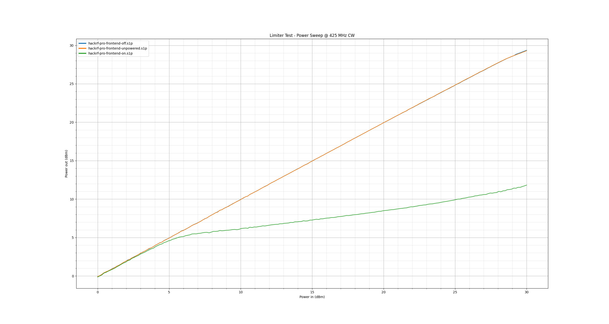
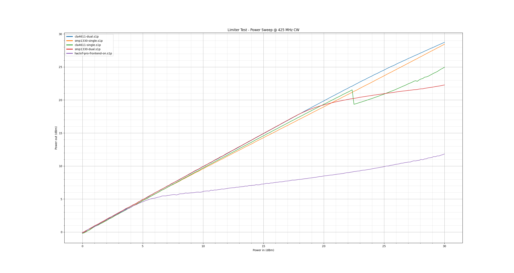
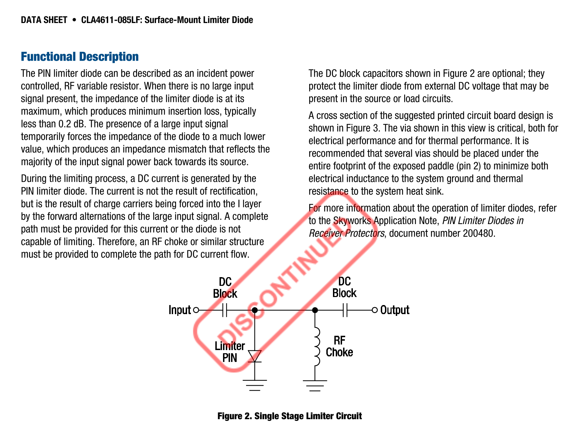
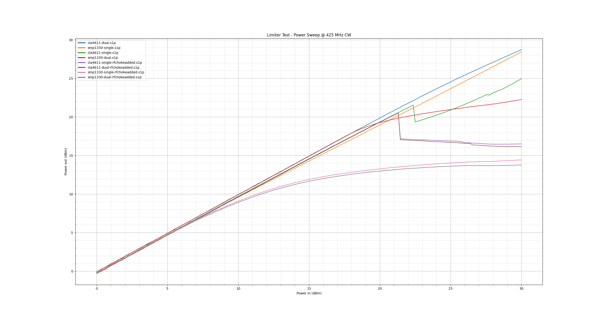

# 2026-07-29 HackRF High Power RF Limiter Testing

This report documents some testing done to verify the high-power performance of the RF power limiter used on HackRF Pro.

I tested with up to 1 Watt of input power at a fixed frequency of 425 MHz. This was chosen to be representative of transmitting nearby from an amateur radio handset, as that may be the most likely source of high power exposure for most users.

The test setup used a vector network analyzer (VNA), an amplifier to boost the incident signal power, a directional coupler to split off a reference signal back to the VNA, and finally an isolator to present a good load match to the output of the amplifier when the limiter was active.

The VNA was then configured to perform a power sweep and was calibrated using a power sensor/power meter after the isolator. I measured S21 for each input power setting, then processed the results to plot power in vs. power out using `data/plot.py`.

## HackRF Pro Results

HackRF Pro uses a switchable limiter so that we can protect the RX LNA while in receive mode, without limiting power in transmit mode. I tested in the 'on' state, 'off' state, and also un-powered which was expected to be equivalent to the 'off' state.

## Limiters used on third-party designs

During maintenance of HackRF One and design of HackRF Pro, we evaluated popular limiter designs from the community that have been used on third-party HackRF One devices but, unfortunately, found them to be unsuitable for our use.

While I had this test setup assembled, I did some more formal testing of those designs.

The common design used has two separate limiter circuits: one using dual diodes between VAA/signal and signal/ground on the main RF input, and a second one with a single diode to ground just before the RX amplifier input. Older designs use SMP1330 diodes and newer ones use CLA4611. I tested each of these in isolation on an evaluation board ([KiCad design files here](https://github.com/greatscottgadgets/misc/tree/master/evaluation-boards/limiters)).

The single SMP1330 and dual CLA4611 both show effectively no limiting, only showing a ~1.5 dB loss at 30 dBm input. The other two configurations seem to start limiting a bit earlier but still rise over 20 dBm
, well beyond the damage level of the RX LNA options available.

When reviewing these designs we noted that the designs were missing an RF choke to ground as required in the data-sheet for the limiter diodes to perform as specified:

As a further test I tried adding an RF choke to ground and re-testing. This had much more reasonable results, though the limiting threshold is still too high for the parts it is meant to protect.

